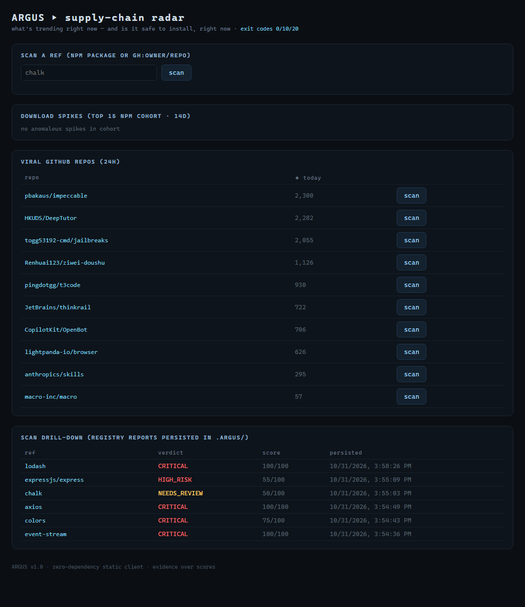
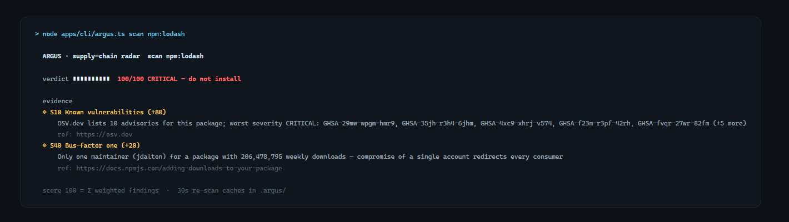

# ARGUS · supply-chain radar

<p align="center">
  
</p>

Your dependencies change faster than you review them. Argus tracks **what's trending on npm and GitHub right now**, verifies whether it's **safe to install, right now**, and gives you one verdict — with the evidence chain, not just a score.

```text
verdict ▮▮▮▮▮▮▮▮▮▮  100/100 CRITICAL — do not install
evidence
◈ S10 Known vulnerabilities (+80)
    OSV.dev lists 10 advisories for this package; worst severity CRITICAL: GHSA-29mw-wpgm-hmr9, …
◈ S40 Bus-factor one (+20)
    Only one maintainer (jdalton) for a package with 206,478,795 weekly downloads —
    compromise of a single account redirects every consumer
```

**Zero runtime dependencies.** The radar itself is Node ≥ 22.13 with nothing installed — `node apps/cli/argus.ts` just runs (TypeScript via native type-stripping).

## Why

Vibe-coders and LLM-driven dev loops install packages from trending pages and model suggestions within seconds. Existing gates (audit, socket, etc.) run *after* you've already adopted a dependency — and none of them look at *velocity*. Argus checks at the moment of install:

- **Spot poisoning** — a familiar package whose daily downloads suddenly explode 8× over its own baseline
- **Shocked-repo injection** — a repo that trends today with 1,000+ stars but is under 6 months old
- **Classic malware** — install scripts, OSV advisories, typosquats against a built-in top-packages index

## Quick start

```bash
# npm source of truth: Node >= 22.13 (native TS type-stripping, zero installs)
node apps/cli/argus.ts scan chalk            # verdict + exit code 0/10/20
node apps/cli/argus.ts trend                 # 14-day download-velocity radar + GitHub trending
node apps/cli/argus.ts watch                 # daemon: rescan persisted refs every 15 min
node apps/api/main.ts                        # dashboard on http://127.0.0.1:8787
```

### Scan any ref

| ref | gate |
| --- | --- |
| `scan npm:lodash` | explicit npm package |
| `scan lodash` | shorthand for `npm:` |
| `scan gh:owner/repo` | GitHub repo incl. dependency-propagation (scans deps!) |
| `scan chalk event-stream gh:octocat/Hello-World` | multiple refs, worst verdict wins |

<p align="center">
  
</p>

## The signals

| id | signal | what it catches |
| --- | --- | --- |
| S10 | Known vulnerabilities | CVEs / malware advisories via OSV.dev |
| S20 | Install scripts | `preinstall` / `postinstall` code execution surface |
| S30 | Fresh-publish spike | brand-new release on a high-velocity package |
| S40 | Bus-factor one | single maintainer holding millions of installs |
| S60 | Typosquat | Levenshtein distance vs built-in top-packages index |
| S70 | Version churn | too many releases in the last 21 days |
| S80 | Repo linkage | missing source repository on a high-traffic package |
| S90 | Repo trust basics | no license / no description on a repo |
| S100 | Viral-no-history | trending today + young repo (24h GitHub pulse) |
| S110 | Dep propagation | a gateway repo whose dependencies are risky on their own |

The merge is **evidence over scores**: findings sum (clamped to 100), severity floors apply, and the `severe-cap invariant` guarantees a report with no severe finding can never cross into HIGH_RISK territory.

## Exit codes (scriptable gates)

| code | verdict |
| --- | --- |
| `0` | SAFE |
| `10` | NEEDS_REVIEW |
| `20` | HIGH_RISK / CRITICAL |
| `3` | package/repo not found |
| `5` | unexpected failure |

Pipe it into CI: `node apps/cli/argus.ts scan chalk || exit 1`.

## Architecture

Hexagonal — pure engine, pluggable providers, thin front doors:

```
engine/          pure logic, fully hermetic · merge, signals, velocity, corpus analysis
shell/           connectors (npm registry, OSV.dev, GitHub, npm downloads) + .argus/ persistence + fixture playback
apps/cli         scan · trend · watch (exit-code contract)
apps/api         loopback server: /api/scan · /api/trend · /api/scans · /healthz
apps/web         zero-dependency static dashboard (served by apps/api)
```

- **Determinism:** `ARGUS_FIXTURES_DIR` replays recorded provider snapshots — CI never touches the network.
- **Reproducibility:** every provider response is content-hashed and logged into the report.
- **Persistence:** `.argus/scans/*.json` (digest-verified, 60 s TTL cache) + `.argus/trend/latest.json`.
- **Tests:** 90+ (unit → integration → e2e incl. golden-corpus regression over 14 refs running through the full engine).
- **Gates:** `npm run lint && npm run typecheck && npm test` (ubuntu + windows matrix CI).

## Development

```bash
npm install                    # dev deps only (eslint + typescript)
npm test                       # 90+ tests, hermetic
npm run record                 # refresh fixture snapshots from live providers
npm run api                    # start the dashboard
```

Docs: [`docs/01-PRD.md`](docs/01-PRD.md) · [`02-ARCHITECTURE.md`](docs/02-ARCHITECTURE.md) · [`03-THREAT-MODEL.md`](docs/03-THREAT-MODEL.md) · [`04-ADR.md`](docs/04-ADR.md) · [`05-SDLC-PLAN.md`](docs/05-SDLC-PLAN.md)

## License

MIT — see [LICENSE](LICENSE).
